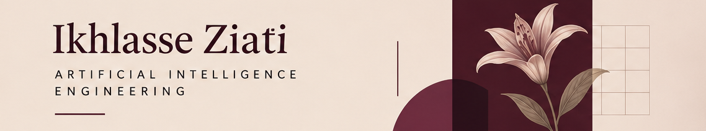

  

 

## 01 — About Me

Final-year Artificial Intelligence Engineering student at the University of Saida, Algeria.

My academic interests include machine learning, generative AI, natural language processing, and the development of intelligent applications.

- **Degree:** State Engineering Degree in Artificial Intelligence
- **Expected graduation:** 2027

 
## 02 — Featured Projects

  

 
## 03 — GitHub Statistics

  

  

 
## 04 — Contribution Activity

  

 
## 05 — Connect

  

  

  

 
