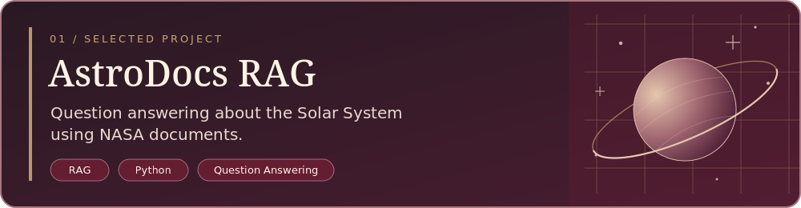

  

 

<h2>01 — About Me</h2>

Final-year Artificial Intelligence Engineering student at the University of Saida, Algeria.

My academic interests include machine learning, generative AI, natural language processing, and the development of intelligent applications.

- **Degree:** State Engineering Degree in Artificial Intelligence
- **Expected graduation:** 2027

 

<h2>02 — Featured Projects</h2>

  

 

<h2>03 — GitHub Statistics</h2>

  

  

<h2>04 — Contribution Activity</h2>

  

 

<h2>05 — Connect</h2>

  
  &nbsp;&nbsp;
  

 

  

